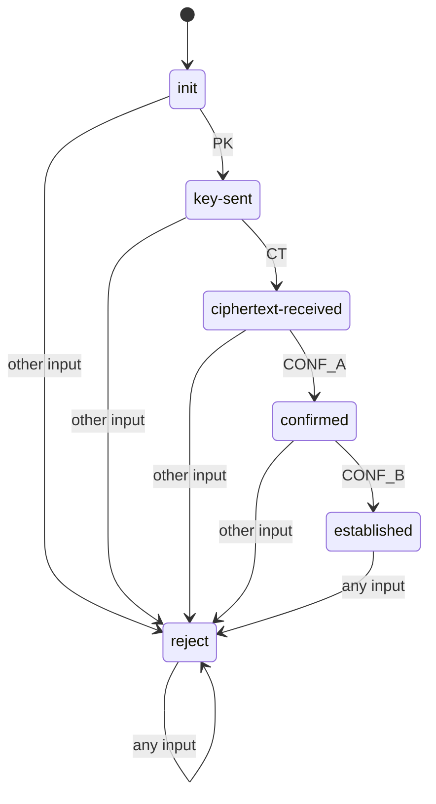

# DFA-enforced ML-KEM-512 handshake

This BACSE201 project connects two Python processes over localhost TCP.
A secure cryptographic primitive alone does not enforce legal protocol order.
Each party uses a DFA to gate the transcript `PK CT CONF_A CONF_B`, rejecting unexpected or malformed complete messages before their cryptographic processing.
ML-KEM creates a candidate secret; HMAC confirmations check possession of that secret.

## Setup and automated tests

```bash
conda activate ml-env
cd /home/daemon_bash/Projects/MOC_PROJECT
python -m pip install --no-deps kyber-py==1.2.0
python dfa_spec.py
python attacks.py
```

If the environment is missing, run `conda create -n ml-env python=3.11 -y`, then repeat the commands above.
If `conda` is unavailable in Bash, first run `source ~/miniconda3/etc/profile.d/conda.sh`.
Only `kyber-py` is required beyond the standard library; Python 3.11.15 and kyber-py 1.2.0 were tested.
Expect `5461 strings checked; language verified`, then 13 PASS rows ending in `13/13 as expected`; a failed evaluation exits nonzero.
The attack script starts and stops its own server process, consumes its startup probe separately, and collects exactly one outcome per test session.

## Two-terminal demonstration

In terminal 1:
```bash
conda activate ml-env
cd /home/daemon_bash/Projects/MOC_PROJECT
python handshake.py server
```
Wait for `[B] listening on 127.0.0.1:5050`, then in terminal 2:
```bash
conda activate ml-env
cd /home/daemon_bash/Projects/MOC_PROJECT
python handshake.py client
```
Both terminals show all four DFA steps and the same 16-character SHA-256 secret fingerprint; A also prints `shared secret matches B (CONF_B verified)`.
Repeat the client command to test a fresh session; its fingerprint should change. Stop the server with Ctrl+C before running `attacks.py`, which needs the same port.
An occupied port or a missing server produces a nonzero error; free port 5050 or start the server as appropriate.
`../moc_review1_backup` preserves the original Review 1 files. The project contains `dfa_spec.py`, `handshake.py`, `attacks.py`, this README, and [info.md](info.md), the complete theory-first team handover; normal script runs do not create bytecode files.

## DFA and acceptance argument

Alphabet: `PK`, `CT`, `CONF_A`, `CONF_B`. Start: `init`. Accepting: `established`. Sink: `reject`.

| State | PK | CT | CONF_A | CONF_B |
|---|---|---|---|---|
| init | key-sent | reject | reject | reject |
| key-sent | reject | ciphertext-received | reject | reject |
| ciphertext-received | reject | reject | confirmed | reject |
| confirmed | reject | reject | reject | established |
| established | reject | reject | reject | reject |
| reject | reject | reject | reject | reject |



There is exactly one nonrejecting path from `init` to `established`, labelled `PK CT CONF_A CONF_B`. A shorter prefix is not accepting; any different symbol or any extension reaches the absorbing sink. Therefore the language is exactly this singleton. The self-check independently enumerates all 5,461 strings of lengths 0–6 and checks the sink transitions; the path argument proves the claim for arbitrary lengths. Unknown symbols, including `INVALID`, also enter the sink.

## Wire format and cryptographic gate

Each frame is a 1-byte type, a 2-byte unsigned big-endian payload length, and that many payload bytes.

| Type | Symbol | Payload bytes |
|---|---|---|
| 1 | PK | 800 |
| 2 | CT | 768 |
| 3 | CONF_A | 32 |
| 4 | CONF_B | 32 |

`recv_msg` loops until the header and payload are complete; EOF raises `ConnectionError`. `classify` maps complete frames to a symbol or `INVALID` using the tag and exact length. Both parties feed sent and received symbols to their own `dfa.step` through `_step`, before the associated crypto. A gates key generation with PK and decapsulation with CONF_A; B gates encapsulation with CT and verifies CONF_A before sending CONF_B. Both use constant-time HMAC comparison. Candidate secrets are used internally for confirmation before acceptance; application release/fingerprint printing requires acceptance and successful peer confirmation. A verifies CONF_B before returning its secret; B returns only an outcome tuple, never its secret. The server uses 2-second socket timeouts and a 1-second post-establishment watch for stray traffic, including partial extra frames.

## Results from a real run

```text
#   Attack          Trace                    Server state at stop  Outcome      Stopped by      Result
1   baseline        PK CT CONF_A CONF_B      established           ESTABLISHED  MAC             PASS
2   replay          honest; replay CONF_A    established           DFA_REJECT   DFA             PASS
3   replay          recorded CONF_A first    init                  DFA_REJECT   DFA             PASS
4   reorder         CT first                 init                  DFA_REJECT   DFA             PASS
5   reorder         CONF_A first             init                  DFA_REJECT   DFA             PASS
6   downgrade       PK CT; send CONF_B       ciphertext-received   DFA_REJECT   DFA             PASS
7   downgrade       legacy tag 0x00          init                  DFA_REJECT   classification  PASS
8   injection       PK with 100 bytes        init                  DFA_REJECT   classification  PASS
9   injection       PK CT; send PK           ciphertext-received   DFA_REJECT   DFA             PASS
10  truncation      PK CT; close             ciphertext-received   INCOMPLETE   session end     PASS
11  truncation      PK header 800; send 100  init                  INCOMPLETE   session end     PASS
12  content (limit) PK CT; random CONF_A     confirmed             MAC_FAIL     MAC             PASS
13  content (limit) recorded PK + CONF_A     confirmed             MAC_FAIL     MAC             PASS
Baseline: matching secrets confirmed by verified CONF_B; no attack was stopped.
Classification maps malformed frames to INVALID; the DFA rejects INVALID.
13/13 as expected
```

Rejections report the state before the illegal transition; MAC failures stop at `confirmed`, and EOF/timeouts report the current state. ML-KEM key-encoding failures also abort as `INCOMPLETE`. No incomplete or MAC-failing session prints B's fingerprint. Extra validation checked fragmented reads, 2,816 classification inputs, client rejection of forged CONF_B, timeouts, and crypto call counts on rejected messages.

## Limitations

- The DFA checks ordering and shape; HMAC checks content/secret possession, including confirmations replayed with a public key in a fresh session.
- There is no identity authentication or PKI; an active intermediary can establish separate sessions. “Matches B” means possession confirmed by the peer, not a verified identity.
- Localhost, one session at a time, per-read timeouts, and a finite stray-traffic watch provide no general denial-of-service protection; later rejection cannot revoke a key already released by A.
- Confirmations are minimal labelled HMACs, without a full key schedule or explicit transcript binding.
- This is educational: [kyber-py](https://github.com/GiacomoPope/kyber-py) is not constant time and is unsuitable for production cryptography.
