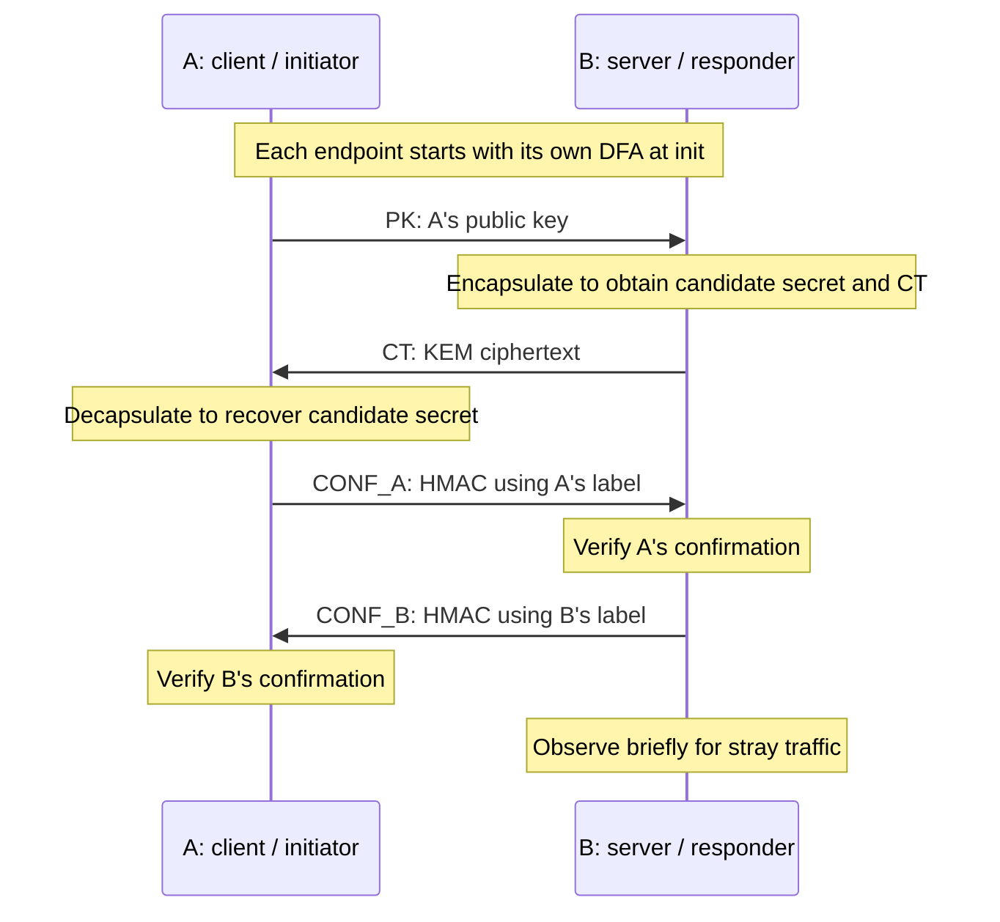
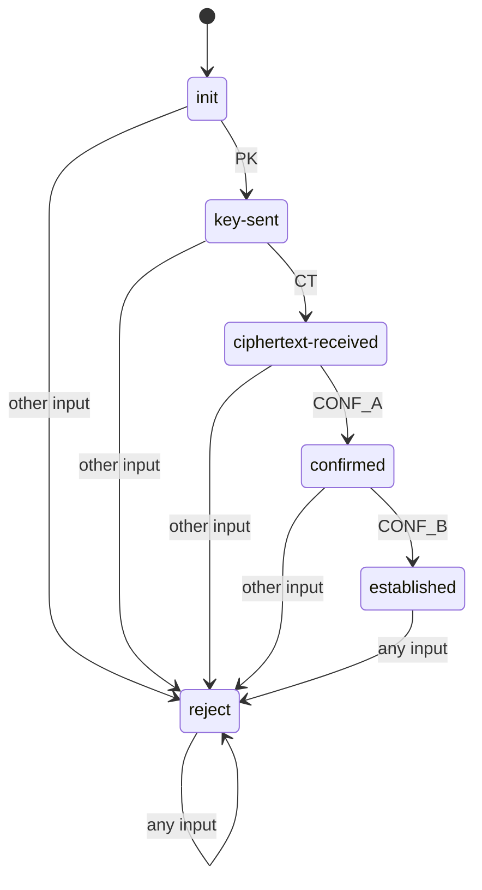

# Understanding the DFA-enforced ML-KEM-512 handshake

This is the team handover guide for the BACSE201 Models of Computation project. It assumes no previous knowledge of this project or cryptographic handshakes. Basic Python knowledge will help with the later walkthrough, but the first part explains the idea without Python code.

Read sections 1–9 first to understand the theory. Sections 10–14 connect that theory to the actual implementation. Sections 15–18 explain how to run, demonstrate, troubleshoot, and discuss the project.

## Contents

1. [The problem we are solving](#1-the-problem-we-are-solving)
2. [Terms you need first](#2-terms-you-need-first)
3. [How ML-KEM creates a shared secret](#3-how-ml-kem-creates-a-shared-secret)
4. [The honest four-message handshake](#4-the-honest-four-message-handshake)
5. [How the DFA enforces the protocol](#5-how-the-dfa-enforces-the-protocol)
6. [How bytes become protocol messages](#6-how-bytes-become-protocol-messages)
7. [The attacker and every evaluated attack](#7-the-attacker-and-every-evaluated-attack)
8. [What each result means](#8-what-each-result-means)
9. [What the project proves and its limits](#9-what-the-project-proves-and-its-limits)
10. [Where each idea lives in the files](#10-where-each-idea-lives-in-the-files)
11. [Walkthrough of dfa_spec.py](#11-walkthrough-of-dfa_specpy)
12. [Walkthrough of handshake.py](#12-walkthrough-of-handshakepy)
13. [Walkthrough of attacks.py](#13-walkthrough-of-attackspy)
14. [Following one complete execution](#14-following-one-complete-execution)
15. [Setup and running the project](#15-setup-and-running-the-project)
16. [Reading results and troubleshooting](#16-reading-results-and-troubleshooting)
17. [Explaining the project to faculty](#17-explaining-the-project-to-faculty)
18. [Understanding checklist and references](#18-understanding-checklist-and-references)

## 1. The problem we are solving

Suppose two programs want to agree on a secret key while communicating over a network. A cryptographic algorithm can help create the secret, but a protocol must decide which messages are allowed, in which order, and when the exchange is complete.

These are different responsibilities. A cryptographic library does not automatically know that a confirmation has arrived too early, that an old message has been repeated, or that a required step was skipped. The application needs rules for those situations.

Our project implements a small protocol with exactly one legal sequence:

**Public key → ciphertext → A's confirmation → B's confirmation.**

A deterministic finite automaton, or DFA, acts as the protocol's order checker. Each endpoint consults its own DFA before performing the cryptographic operation associated with the next step. Unexpected messages move the DFA to a permanent rejection state and stop that session.

The project combines four responsibilities:

- **ML-KEM-512:** creates a shared secret between the parties.
- **Message classification:** checks that incoming messages have a known type and the required size.
- **DFA:** checks whether a classified message is allowed at this point in the exchange.
- **HMAC confirmation:** checks that the peer can produce the correct confirmation using the shared secret.

The course contribution is the connection between a formal language and executable protocol enforcement. We use a library for the cryptographic primitive; we implement the protocol around it.

## 2. Terms you need first

- **Party A / client / initiator:** the program that starts the connection and sends the public key.
- **Party B / server / responder:** the program that listens for a connection and responds to the public key.
- **Handshake:** the initial exchange through which the parties establish and confirm a shared secret.
- **Session:** one connection with a fresh protocol state. A new session starts again at `init`.
- **Public key:** information that may be sent openly and is used by B to encapsulate a secret.
- **Private key:** information kept by A and used to recover the corresponding secret. It is never sent over the socket.
- **Shared secret:** the same secret byte string obtained by both parties after a successful exchange.
- **Ciphertext:** the public encapsulation output sent by B so A can recover the secret with its private key.
- **Confirmation:** a short keyed value that the peer must reproduce using the candidate shared secret.
- **Transcript:** the ordered messages in a session. In the theory, we usually discuss just their symbols; in the client code, we also record their payload bytes.
- **Payload:** the contents of a message, excluding the header that identifies its type and length.
- **State:** the DFA's record of how far the transcript has progressed.
- **Transition:** the DFA rule that selects a new state from the current state and next symbol.
- **Reject sink:** a state that can never return to an accepting state.
- **EOF:** end of stream. A socket read returning no bytes means the peer has closed its sending side.
- **Timeout:** a socket operation did not complete within its configured waiting time.

Keep the distinction between *public key*, *private key*, and *shared secret*: they are three different objects with different roles.

## 3. How ML-KEM creates a shared secret

ML-KEM means **Module-Lattice-Based Key-Encapsulation Mechanism**. It is standardized by NIST in FIPS 203 and is designed around a mathematical problem believed to resist both classical and quantum attacks. ML-KEM-512 is one of its parameter sets. This project calls its existing implementation rather than implementing lattice mathematics. See [NIST FIPS 203](https://csrc.nist.gov/pubs/fips/203/final).

At the level needed for this project, there are three operations:

1. **Key generation:** A generates a public key and a corresponding private key. A sends the public key and keeps the private key.
2. **Encapsulation:** B uses A's public key and fresh randomness to obtain a candidate shared secret and a ciphertext. B keeps the secret and sends the ciphertext.
3. **Decapsulation:** A uses its private key and B's ciphertext to recover the corresponding candidate secret.

For an honest exchange, A and B obtain the same secret without transmitting the secret itself. The wire carries the public key, ciphertext, and later confirmations. It never carries the private key or raw shared secret.

The name “512” does not mean that this project's shared secret contains 512 bytes or 512 bits. In the implementation, the public key is 800 bytes, the ciphertext is 768 bytes, and the shared secret is 32 bytes, or 256 bits.

A KEM establishes key material; this project does not send an encrypted chat message or file afterward. The ciphertext here is a KEM ciphertext, not an encrypted application message supplied by the user. Adding encrypted application traffic would require additional protocol design beyond this project.

### Why the shared secret needs confirmation

Obtaining a candidate secret locally does not by itself show that the peer obtained the same value. We therefore add two HMAC confirmations.

HMAC is a message authentication code built from a secret key and a hash function. Here, HMAC-SHA256 takes the candidate secret as its key and a fixed role label as its message:

- A's confirmation uses the label `CONF_A`.
- B's confirmation uses the label `CONF_B`.

Each confirmation is 32 bytes long. The receiver computes the expected value using its own candidate secret and compares it with the received value. Successful verification provides evidence that the peer possesses the same secret, assuming the cryptographic operations are secure.

The two labels distinguish the roles: a captured A-confirmation cannot simply be reflected back as B's confirmation. These are still minimal confirmations; they do not explicitly include the entire transcript, identities, or a session identifier.

### Confirmation is different from a fingerprint

A **fingerprint** in this demo is the first 16 hexadecimal characters of the SHA-256 hash of the secret. It is a short display value, not the secret itself and not the HMAC confirmation.

Both terminals should display matching fingerprints after an honest exchange. The actual protocol check is the HMAC verification; a short fingerprint comparison is only a convenient visual check and is not a proof of identity or an equivalent replacement for HMAC.

## 4. The honest four-message handshake

The message symbols are:

- `PK`: A's public key.
- `CT`: B's KEM ciphertext.
- `CONF_A`: A's HMAC confirmation.
- `CONF_B`: B's HMAC confirmation.

The arrows below show network direction. Neither the shared secret nor the private key appears as a transmitted message.



The full sequence is `PK CT CONF_A CONF_B`. It contains both sent and received messages from either endpoint's perspective:

| Endpoint | First | Second | Third | Fourth |
|---|---|---|---|---|
| A | send PK | receive CT | send CONF_A | receive CONF_B |
| B | receive PK | send CT | receive CONF_A | send CONF_B |

Both DFAs process the same symbols in the same order, even though the directions are opposite. The DFAs are independent objects in separate processes; they do not share memory or update one another.

After a valid confirmation exchange, A may return its secret to its caller. B's function returns only a session outcome; it does not return the secret to the attack runner. Both endpoints can print a fingerprint after their success conditions are satisfied.

The candidate secret must be used internally before final acceptance to compute the confirmations. “Do not release the key before success” means no application use, returned secret, or success fingerprint before the required checks pass; it cannot mean “never use the candidate secret to compute a confirmation.”

## 5. How the DFA enforces the protocol

### The formal components

A DFA is usually described as the five-part object `(Q, Σ, δ, q0, F)`:

- `Q` is the finite set of states.
- `Σ`, called sigma, is the input alphabet.
- `δ`, called delta, is the transition function.
- `q0` is the initial state.
- `F` is the set of accepting states.

For this project:

- `Q = {init, key-sent, ciphertext-received, confirmed, established, reject}`.
- `Σ = {PK, CT, CONF_A, CONF_B}`.
- `q0 = init`.
- `F = {established}`.
- `δ` is the transition table below.

“Deterministic” means that the same state and symbol always select exactly one next state. The DFA does not need randomness or the secret key to make its decision.

### What the states mean

| State | Transcript prefix allowed so far |
|---|---|
| `init` | Empty; no protocol symbol processed yet |
| `key-sent` | `PK` |
| `ciphertext-received` | `PK CT` |
| `confirmed` | `PK CT CONF_A` |
| `established` | `PK CT CONF_A CONF_B` |
| `reject` | An illegal symbol or extra message was processed |

The names describe progress through the common transcript, not literal local socket activity. For example, B enters `ciphertext-received` when it processes its **outgoing** CT step. Also, `confirmed` means the CONF_A symbol was allowed; the subsequent HMAC verification can still fail.

### The complete transition table

Read each row as “if we are in this state, what happens for the next symbol?”

| Current state | PK | CT | CONF_A | CONF_B |
|---|---|---|---|---|
| init | key-sent | reject | reject | reject |
| key-sent | reject | ciphertext-received | reject | reject |
| ciphertext-received | reject | reject | confirmed | reject |
| confirmed | reject | reject | reject | established |
| established | reject | reject | reject | reject |
| reject | reject | reject | reject | reject |

There are 6 states and 4 alphabet symbols, giving 24 explicit entries. Every known state/symbol combination has a defined result, so the transition table is total over `Q × Σ`.

The implementation also handles inputs outside the alphabet, such as `INVALID`, by sending them to the existing `reject` state. This is a defensive extension at the input boundary; `INVALID` is not a fifth symbol in the four-symbol language being enumerated.



### The accepted language

A formal language is a set of strings over an alphabet. Here, a “string” means a sequence of message symbols, not the literal characters in a network message.

Our language contains exactly one string:

**L = {PK CT CONF_A CONF_B}.**

For example:

- The empty sequence is not accepted because it ends at `init`.
- `PK CT` is not accepted because it ends at `ciphertext-received`.
- `PK CONF_A` is rejected because CONF_A is too early.
- `PK CT CONF_A CONF_B` is accepted.
- `PK CT CONF_A CONF_B CONF_A` is rejected because it has an extra message.

### Why this language claim holds

From `init`, the only way to avoid rejection is PK. From there, the only way forward is CT, then CONF_A, then CONF_B. Every proper prefix ends in a nonaccepting state, every deviation goes to the sink, and every extension beyond the four-message sequence also goes to the sink. Since the sink cannot be escaped, no other sequence can end in the accepting state.

The executable self-check enumerates lengths 0 through 6. The number of strings examined is `4^0 + 4^1 + ... + 4^6 = 1 + 4 + 16 + 64 + 256 + 1024 + 4096 = 5461`. Exactly one should be accepted.

That finite enumeration checks the implementation for those lengths. The path-and-sink argument above is the reason the claim holds for **all** lengths; a finite test alone is not a proof about arbitrarily long strings.

## 6. How bytes become protocol messages

### TCP and localhost

TCP provides a stream of bytes. One send does not necessarily correspond to one receive: a message may arrive in pieces, or several messages may be available together. The receiver therefore needs a framing rule to identify message boundaries.

Both programs run on the same machine but communicate through a real TCP connection to `127.0.0.1`, the loopback address. Port `5050` identifies the server endpoint. Running locally makes the demonstration easy to reproduce while preserving the separation between client and server processes.

TCP's ordered delivery does not prevent our reordering attacks. The attacker deliberately sends **application messages** in the wrong logical order; the network can faithfully deliver that wrong sequence.

### The frame format

Each frame contains three parts:

1. One byte containing the type tag.
2. Two bytes containing the payload length, in big-endian order.
3. Exactly that many payload bytes.

Big-endian means the most significant byte comes first. A payload length of 800 is represented by the two bytes `03 20` in hexadecimal.

| Tag | Symbol | Required payload size | Total frame size |
|---|---|---|---|
| 1 | PK | 800 bytes | 803 bytes |
| 2 | CT | 768 bytes | 771 bytes |
| 3 | CONF_A | 32 bytes | 35 bytes |
| 4 | CONF_B | 32 bytes | 35 bytes |

### Classification, ordering, and content

The receiver performs different checks at different stages:

1. **Framing:** obtain the complete header and the number of payload bytes advertised by that header.
2. **Classification:** verify that the type is known and the completed payload has the required length for that type.
3. **Ordering:** give the resulting symbol to the DFA.
4. **Content processing:** perform the permitted cryptographic operation or verify the confirmation.

A complete frame with an unknown tag or a wrong type-specific length becomes `INVALID`, and the DFA rejects it. A complete, correctly sized frame can still contain bad cryptographic content; classification does not prove that a public key or confirmation is valid.

Two superficially similar cases behave differently:

- A header advertises **100 bytes**, tagged PK, and all 100 arrive. The frame is complete but has the wrong PK size, so classification returns `INVALID`.
- A header advertises **800 bytes**, tagged PK, but only 100 arrive before the sender closes. The frame is incomplete, so framing fails before classification or the first DFA transition.

The second case is truncation, not a completed message with a bad declared shape.

## 7. The attacker and every evaluated attack

### What the attacker controls

The automated evaluation starts an honest B server in a separate process. The attacker takes A's place and opens fresh localhost connections. It can choose message types, payloads, order, and when to close the connection. It can also record messages from an honest run and reuse them.

The attacker does not read B's private process memory, overwrite B's DFA, or receive B's secret through the results queue. Its tests operate through the socket interface. The raw attack-sending path deliberately does not enforce A's honest protocol rules; otherwise it could not generate illegal traces for B to reject.

The suite has **13 rows: one honest baseline, ten examples across five attack classes, and two content-forgery examples that demonstrate the DFA's boundary**. Class names describe the attacker's intent, so two classes can use identical message bytes.

### Row 1: honest baseline

**Trace:** `PK CT CONF_A CONF_B`.

A and B execute the complete protocol and verify the confirmations. B reports `ESTABLISHED` at `established`, and A verifies CONF_B before returning its secret.

This establishes that legal communication works. The attack runner confirms agreement through the verified HMAC, rather than transporting B's raw secret through its results queue. The manual demo additionally lets you compare the printed fingerprints.

### Replay: reuse a previously valid message

Replay attacks reuse old message bytes, hoping the receiver will accept them in a new context.

**Row 2 — replay after completion.** Run an honest handshake, then resend that session's recorded CONF_A. B is already at `established`, where every additional symbol is forbidden. It reports `DFA_REJECT` with the previous state `established`; it does not verify the replayed HMAC.

**Row 3 — replay at the start of a fresh session.** Send a recorded CONF_A as the very first message on a new connection. B starts at `init`, where only PK is legal, so it reports `DFA_REJECT` at `init`.

The DFA rejects these because of where they appear. It does not maintain a database of old message hashes. A replay that follows legal order requires a content check; row 13 demonstrates that distinction.

### Reordering: send a protocol step too early

Reordering attacks violate dependencies between steps. The bytes may have the expected size for a known message type, but the receiver is not ready for that step.

**Row 4 — CT first.** Send a correctly sized recorded ciphertext before any PK. Classification returns CT, but the `init` state permits only PK. The result is `DFA_REJECT` at `init`.

**Row 5 — CONF_A first.** Send CONF_A before establishing any key material in this session. The result is again `DFA_REJECT` at `init`.

Rows 3 and 5 use the same kind of first message in the implementation. Row 3 emphasizes reuse of a recording; row 5 emphasizes illegal order. They are two attack interpretations, not two different DFA transitions.

### Downgrade: try to bypass required protocol rules

In this project, downgrade means an attempt to skip a mandatory confirmation or request an unsupported legacy mode. There is no real menu of cryptographic algorithms being negotiated.

**Row 6 — skip A's confirmation.** Send PK, receive CT, and then send CONF_B instead of CONF_A. B is at `ciphertext-received`, where only CONF_A is allowed. It reports `DFA_REJECT` at `ciphertext-received`.

**Row 7 — request “legacy mode.”** Send a frame with type tag `0x00`. That tag is not supported. Classification produces `INVALID`, and the DFA rejects it at `init`. No weaker mode is entered because the implementation contains no such fallback.

These demonstrate refusing weakened protocol behavior, not comprehensive protection for a multi-version negotiation system.

### Injection: insert an invalid or unexpected message

Injection means adding attacker-chosen data to the exchange. Our two examples separate malformed shape from an unexpected but correctly shaped message.

**Row 8 — PK with a 100-byte payload.** Send a complete frame claiming to be PK whose advertised and actual payload lengths are both 100. A valid PK must be 800 bytes. Classification returns `INVALID`; the DFA rejects it at `init` before encapsulation.

**Row 9 — a second PK midway through the handshake.** Send a valid PK, receive CT, and send PK again. The second message has valid PK shape, but B now expects CONF_A. It reports `DFA_REJECT` at `ciphertext-received`. The first PK already caused legitimate encapsulation; the second PK does not cause another encapsulation.

### Truncation: end the exchange before it is complete

Truncation attacks stop the handshake or cut a frame short. No complete offending symbol needs to reach the DFA for the session to fail.

**Row 10 — close after receiving CT.** Send PK, read B's CT, and close without sending CONF_A. B is still at `ciphertext-received`. Its read encounters EOF, so it reports `INCOMPLETE`; B does not print a success fingerprint.

**Row 11 — cut a PK frame short.** Send a PK header advertising 800 bytes, send only 100 payload bytes, then close. The framing code cannot obtain a complete message. B reports `INCOMPLETE` at `init`, because no PK symbol has yet been classified and consumed.

The DFA contributes the nonaccepting state, while EOF/timeout handling detects that no more usable input is arriving. A DFA alone does not know when a peer has disconnected.

### Content forgery: legal order with an invalid confirmation

These final cases intentionally pass the order and shape checks. They show why the DFA must be combined with cryptographic verification.

**Row 12 — random CONF_A.** Send a valid PK, receive CT, and send 32 random bytes tagged CONF_A. Its tag, length, and position are legal, so B's DFA advances to `confirmed`. The HMAC comparison fails, producing `MAC_FAIL` at `confirmed`. B does not send CONF_B or print a success fingerprint.

**Row 13 — recorded PK and recorded CONF_A in a new session.** Reuse a recorded public key, receive a freshly generated CT from B, and then send the old CONF_A. The order is legal. However, fresh encapsulation produces a new candidate secret, so the old confirmation does not match the new expected HMAC, and B reports `MAC_FAIL` at `confirmed`.

Reusing a public key alone is not what the DFA rejects. The relevant failure is that the recorded confirmation does not prove possession of the new session's secret. As with other cryptographic checks, these outcomes rely on secure randomness and negligible forgery/collision probabilities, rather than a mathematical guarantee that every random value differs.

## 8. What each result means

The server returns a three-item outcome: a state, a symbol or diagnostic marker, and an outcome name.

| Outcome | Meaning |
|---|---|
| `ESTABLISHED` | B completed its confirmation checks and the post-establishment observation finished without detected extra traffic |
| `DFA_REJECT` | A classified input was illegal in the current state, and the DFA entered `reject` |
| `MAC_FAIL` | CONF_A was legal in shape/order but failed B's HMAC verification |
| `INCOMPLETE` | The session could not complete because of an I/O failure, timeout, or the library's key-content validation failure |

The “Server state at stop” column needs careful interpretation:

- For `DFA_REJECT`, it shows the state **before** rejection. The DFA's actual new state is `reject`.
- For a server `MAC_FAIL`, it shows `confirmed`: the CONF_A symbol was processed before the HMAC failed.
- For `INCOMPLETE`, it shows the state reached before the session aborted.
- For successful completion, it shows `established`.

The “Stopped by” column identifies the responsible layer. “Classification” means classification produced `INVALID` and the DFA then rejected that input. “Session end” means EOF interrupted the required exchange. “MAC” means cryptographic confirmation detected the forgery.

The baseline also displays “MAC” because the confirmation verifies agreement, but no attack is stopped in that row; the script explicitly explains this below the table.

Finally, `PASS` means the **test outcome matches the expected state and outcome**, not that the attack succeeded. A replay row reporting `DFA_REJECT` and `PASS` means the defense behaved as expected.

## 9. What the project proves and its limits

### What we can claim

The formal model recognizes exactly the intended four-symbol sequence. The implementation places that model in each endpoint's execution path, classifies incoming frames, and demonstrates expected handling of the 13 specified cases over real localhost TCP. HMAC confirmation supplies a check that the symbol-only automaton cannot perform.

The precise crypto-gating claim is: **an order-invalid or shape-invalid complete message is rejected before the cryptographic processing associated with that offending message**. Earlier legal messages in the same session may already have caused crypto. Content forgeries with valid order and shape deliberately reach cryptographic verification.

### Boundaries to explain honestly

- **No identity authentication:** there are no certificates, signatures, trusted public-key registry, or pre-shared identity credential. A malicious intermediary could establish separate exchanges with each side. “Matches B” means the connected peer supplied a valid confirmation, not that its real-world identity is verified.
- **No general replay-history mechanism:** the DFA has no timestamps, counters, or persistent replay cache. It rejects illegal placement; fresh encapsulation and confirmation detect the evaluated replay that follows legal order.
- **The DFA tracks symbols, not all program facts:** it does not encode socket direction, key validity, HMAC success, or elapsed time. Procedural code and cryptographic checks enforce those additional conditions.
- **Acceptance alone is insufficient:** A advances to `established` before checking the received CONF_B content. If that check fails, A raises an error and never returns its secret or prints its success fingerprint, even though the symbol sequence was accepted.
- **Minimal confirmation design:** HMAC is applied to fixed role labels using the candidate secret directly. There is no full key schedule, dedicated confirmation keys, or explicit binding of identities and the entire transcript.
- **Finite observation after success:** B watches for the first stray byte for up to one second. Once traffic is detected, reading its frame can take further time. A has already verified CONF_B and may have returned its secret; a later rejection by B cannot undo that release.
- **Sequential localhost demonstration:** B handles one connection at a time. Socket timeouts apply to individual blocking operations, not a strict whole-session deadline. This is not comprehensive denial-of-service protection or a concurrent server.
- **No application-data protocol:** after the handshake, there is no encrypted messaging layer to demonstrate.
- **Educational cryptographic implementation:** the upstream [kyber-py project](https://github.com/GiacomoPope/kyber-py) states that it is not constant time and is not intended for production cryptography.

The internal mathematics of ML-KEM and a complete authenticated secure-channel design are outside this project's implementation scope. Understanding these boundaries is part of understanding the project, rather than a gap to hide during a presentation.

## 10. Where each idea lives in the files

The theory above is now enough to read the implementation. The source is divided by responsibility:

| File | Responsibility | Start reading at |
|---|---|---|
| [dfa_spec.py](dfa_spec.py) | Defines the automaton and checks its accepted language | `TRANSITIONS`, then `HandshakeDFA.step` |
| [handshake.py](handshake.py) | Defines framing, classification, confirmations, both endpoints, and the server loop | `classify`, then `run_client` and `run_server` |
| [attacks.py](attacks.py) | Runs the attacker traces and compares measured outcomes with expectations | `CASES`, then `_attack` and `main` |
| [README.md](README.md) | Short setup/design reference with recorded results | Setup and results sections |
| [info.md](info.md) | This longer theory-first handover | Read in section order |

The code dependencies are simple: `handshake.py` imports the DFA and `kyber-py`; `attacks.py` imports the network helpers and endpoint functions from `handshake.py`. The DFA module can run independently without importing the cryptographic library.

The only third-party runtime dependency is `kyber-py`. Socket handling, byte packing, HMAC, hashing, processes, queues, timing, and output capture use Python's standard library.

The current project grew from an in-process Review 1 prototype. That older version is backed up in `../moc_review1_backup` on the original development machine. The current implementation adds real TCP endpoints, independent DFAs, verification of B's confirmation by A, and the full evaluation suite. The backup is not required to run the current project.

## 11. Walkthrough of dfa_spec.py

### Constants and TRANSITIONS

`ALPHABET` contains the four allowed symbols. Constants such as `INIT` and `REJECT` hold the state names. `STATES` lists all six states, and `ACCEPTING_STATES` contains only `ESTABLISHED`.

`TRANSITIONS` is a dictionary keyed by a pair: `(current_state, symbol)`. Its values are next states. For example:

```python
(INIT, "PK"): KEY_SENT,
(INIT, "CT"): REJECT,
```

The first rule permits PK at the start. The second rejects CT at the start. The complete dictionary implements exactly the table in section 5.

### DFARejection

`DFARejection` is an exception, which means it interrupts normal execution when raised. It records `previous_state` and `symbol` so the caller can report where and why rejection occurred.

It inherits from `RuntimeError`. The server catches this specific exception and converts it into a `DFA_REJECT` outcome. The client lets it propagate to its caller; the command-line wrapper prints an error and exits unsuccessfully.

### HandshakeDFA

The constructor starts a new object in `init` unless a different valid starting state is supplied. It rejects unknown initial state names. Each object has its own mutable `state`; by default, the objects refer to the common transition dictionary, which normal protocol execution does not modify.

The optional transition argument makes it possible to supply a table for inspection/testing, but neither normal endpoint supplies a custom one.

The `accepted` property asks only whether the current state belongs to the accepting set. It does not inspect message payloads or verify a MAC.

The central method is:

```python
def step(self, symbol):
    previous_state = self.state
    self.state = self.transitions.get((self.state, symbol), REJECT)
    if self.state == REJECT:
        raise DFARejection(previous_state, symbol)
    return self.state
```

The dictionary lookup either finds a defined transition or uses `REJECT` as the default. An unknown string such as `INVALID` therefore reaches the sink instead of producing a separate “unknown symbol” error. The object is moved into `reject` **before** the exception is raised, so rejection cannot leave it in its previous usable state.

The term “implicit dead state” in the comment refers to the default handling of unknown inputs. It does not add a seventh state; `reject` is already in the state set.

### accepts(trace)

`accepts` evaluates a complete sequence using a local `state` variable. It uses the same transition rules but returns a Boolean instead of raising protocol-rejection exceptions. It has no socket, secret, or mutable DFA object shared with its caller.

That makes it convenient for enumerating many candidate strings. It is not the function used to authorize live network operations; live endpoints use `HandshakeDFA.step`.

### The executable self-check

The `if __name__ == "__main__":` block runs when this file is executed directly, but not when another file imports it. It uses `itertools.product` to generate every sequence of each length from 0 to 6, counts them, and collects the accepted ones.

Assertions check that the count is 5,461, the accepted list contains exactly the required sequence, the table has 24 entries, every alphabet transition from `reject` stays there, and an `INVALID` input is not accepted. Use normal `python`, without the `-O` optimization flag, because these self-checks use Python assertions.

## 12. Walkthrough of handshake.py

### Imports and constants

`socket` supplies TCP connections; `struct` packs the header; `hmac` and `hashlib` implement confirmations and display fingerprints; `sys` handles command-line arguments. The file imports `ML_KEM_512` and the two DFA classes.

`HOST` is `127.0.0.1`, `PORT` is `5050`, `TYPES` maps symbols to numeric tags, and `SIZES` maps symbols to required payload sizes. Setting `sys.dont_write_bytecode` avoids generated bytecode files during the documented script runs; it is unrelated to protocol security.

### send_msg(sock, symbol, payload)

```python
sock.sendall(struct.pack("!BH", TYPES[symbol], len(payload)) + payload)
```

`!` requests network byte order, `B` packs a one-byte unsigned integer, and `H` packs a two-byte unsigned integer. `sendall` handles sending the entire buffer or raises an error.

This helper creates a frame; it does not enforce the protocol state or require a valid payload size for the symbol. That is why the attacker can use it to send a PK with 100 bytes. Honest endpoints apply their own DFA steps, and the receiver classifies what actually arrives. An unknown numeric tag is sent with raw socket bytes because it is absent from the `TYPES` mapping.

### _recv_exact(sock, size) and recv_msg(sock)

`_recv_exact` repeatedly receives only the number of bytes still needed, appends them to a byte buffer, and returns once it has exactly `size` bytes. If a receive returns no bytes first, it raises `ConnectionError`. Socket timeout errors propagate to the caller as well.

`recv_msg` uses that helper twice: first for the three-byte header, then for the advertised payload length. It returns `(type_byte, payload)`. It does not yet decide whether the type/length combination is a legal protocol message.

Reading only the needed bytes also means that bytes from the next frame remain available for the next call.

### classify(type_byte, payload)

`classify` looks through the known symbols and returns one only when **both** the tag and actual payload length match. Otherwise it returns `INVALID`.

It does not inspect the mathematical encoding of a public key or the contents of a confirmation. An 800-byte string tagged PK can pass classification and later fail ML-KEM's own key validation.

### _confirmation(secret, label)

```python
return hmac.new(secret, label, hashlib.sha256).digest()
```

This computes a raw 32-byte HMAC-SHA256 value. `b"CONF_A"` and `b"CONF_B"` are byte strings, matching the bytes expected by the HMAC API. The result is transmitted as the confirmation payload.

### _step(dfa, party, direction, symbol)

This wrapper remembers the old state, calls `dfa.step(symbol)`, and prints the transition. The print is inside `finally`, so the transition is logged even if the DFA raises an exception.

It does not swallow the exception. For example, if a second PK is rejected, execution leaves `_step` immediately afterward; subsequent crypto lines in the caller are not reached.

The `party` and `direction` arguments are log labels, not additional DFA inputs. Also, a “send” log records authorization of that step before crypto and socket sending; it does not itself prove that the bytes were successfully transmitted.

### run_client(sock): A's complete execution

The client sets a two-second socket timeout and creates a fresh DFA and empty transcript list.

1. **Authorize PK.** `_step(..., "PK")` advances to `key-sent`. Only then does `keygen()` create A's public/private key pair. A sends PK and appends it to the transcript.
2. **Receive and authorize CT.** A reads a complete frame, classifies it, and steps using the actual returned symbol. A malformed or unexpected response is rejected here. A records the accepted ciphertext.
3. **Authorize CONF_A and recover the secret.** A advances to `confirmed`, calls `decaps(private_key, ciphertext)`, computes CONF_A, sends it, and records it. Decapsulation is placed under the outgoing CONF_A step because recovering the secret is the operation needed to construct that confirmation; the incoming CT step has already been accepted.
4. **Receive and verify CONF_B.** A reads and classifies the frame, then steps its DFA. For a valid CONF_B symbol, this reaches `established`. A computes the expected B-confirmation and compares it with `hmac.compare_digest`. A mismatch raises `ValueError` with a `MAC_FAIL` message.
5. **Release the result.** Only after successful verification does A append CONF_B, assert acceptance, print a fingerprint and the match message, and return `(secret, transcript)`.

The transcript is a list of `(symbol, payload)` pairs. It records the four protocol messages; it does not contain the private key or raw shared secret. The secret is returned separately to the caller after success.

For the library API, `keygen()` returns `(public_key, private_key)`, `encaps(public_key)` returns `(secret, ciphertext)`, and `decaps(private_key, ciphertext)` returns the secret. The order of the two encapsulation outputs matters when reading the code.

### run_server(sock): B's complete execution

B sets a two-second socket timeout and creates a fresh DFA for this connection.

1. **Receive and authorize PK.** B reads, classifies, and steps the first message. Any initial symbol other than PK is rejected before encapsulation.
2. **Authorize CT and encapsulate.** B steps the outgoing CT symbol, calls `encaps(public_key)`, keeps the candidate secret locally, and sends the ciphertext. Its DFA is now at `ciphertext-received`.
3. **Receive and verify CONF_A.** B reads, classifies, and steps the next input. A legal CONF_A advances the DFA to `confirmed`; B then checks the HMAC. Failure returns `(confirmed, CONF_A, MAC_FAIL)` without sending CONF_B.
4. **Authorize and send CONF_B.** After A's confirmation passes, B steps CONF_B, computes B's HMAC, and sends it. Its DFA is now at `established`.
5. **Observe for stray input.** B temporarily sets a one-second timeout and peeks at the next byte using `MSG_PEEK`. Peeking checks for data without removing it from the socket's receive buffer.
6. **Finish or reject extra input.** No byte before the timeout, or clean EOF with no extra data, completes the observation. If a byte is present, B restores the two-second timeout and tries to read/classify the extra frame. A complete extra message is fed to the DFA and rejected at `established`. A partial extra frame that ends or times out is represented as `INVALID` and also rejected there.
7. **Report success.** If no extra input caused rejection, B checks acceptance, prints the fingerprint, and returns `(established, CONF_B, ESTABLISHED)`.

The final symbol in the success tuple is a reporting convention; it does not mean B received CONF_B from A.

### How server errors become outcomes

The function handles three exception categories around its main flow:

- `DFARejection`: return the stored previous state and offending symbol with `DFA_REJECT`.
- Socket/connection errors, including timeout: print the error and return the current state with the marker `EOF/timeout` and `INCOMPLETE`.
- `ValueError` from cryptographic content validation: print the validation problem and return `INCOMPLETE`.

An invalid public-key encoding is therefore different from a wrong public-key length. The former can reach the library after the legal PK/CT steps and abort as incomplete; the latter becomes `INVALID` before encapsulation.

### serve(port, results_queue=None)

`serve` creates a listening socket, binds the address and port, and repeatedly accepts connections. `SO_REUSEADDR` supports rebinding in common restart situations; it does not allow a second active server to take over the same listening endpoint.

For each accepted socket, it calls `run_server`, closes that connection, prints its outcome, and optionally puts the outcome tuple on a multiprocessing queue. Then it accepts the next connection, which will get a fresh DFA.

The listener's two-second accept timeout allows the loop to continue while idle; it is not an incomplete client session because no connection has been accepted yet. The server is sequential: it finishes one session before handling the next.

### Command-line entry point

The final block reads `sys.argv[1]` when exactly one argument is supplied:

- `server` starts `serve(PORT)`.
- `client` connects to the server and calls `run_client`.
- Missing or invalid arguments print a usage error.

The socket context managers close sockets when their blocks finish, including on exceptions. Ctrl+C stops the command-line server cleanly. Client connection, DFA, and confirmation failures produce a nonzero exit with an explanation.

## 13. Walkthrough of attacks.py

### CASES is the evaluation specification

Each entry stores five fields: the attack label, displayed trace, expected state, expected outcome, and responsible layer. The script numbers these entries from 1 to 13.

These are declared expectations, not observations. The actual state and outcome come from the separately running server and are compared with those expectations later.

### _serve_quietly(results)

This starts the ordinary `serve` function while capturing its normal printed logs in memory. The results queue still carries each server outcome. Capturing the verbose step logs keeps the final evaluation table readable; it does not bypass any protocol checks.

A server startup error, such as an occupied port, is reported as an error rather than producing a successful evaluation.

### _wait_for_server(process, results)

The attacker needs to wait until its new server is accepting connections. It attempts a short connection during a bounded startup period.

That readiness connection is immediately closed without sending a message. Consequently, the honest server records a real `INCOMPLETE` session at `init`. The helper consumes and checks this queue entry before the 13 test rows begin.

This detail prevents an off-by-one error where row 1 would accidentally be compared with the startup probe's outcome. The startup probe is not an attack-table row.

### _attack(sock, number, recorded)

This function sends the selected trace using the current connection:

- Rows 1 and 2 call the honest `run_client`. Because that function verifies CONF_B before returning, successful return supplies the baseline confirmation check. Row 2 then sends an additional recorded CONF_A.
- The returned transcript is converted to a dictionary so recorded payloads can be selected by symbol. This is safe for the honest four-message transcript because each symbol appears once.
- Rows 3 and 5 send recorded CONF_A first; row 4 sends recorded CT first.
- Row 7 sends a manually packed unknown type header; row 8 uses `send_msg` with the wrong PK payload length.
- Row 11 manually packs a header advertising 800 bytes and appends only 100 bytes, deliberately creating an unfinished frame.
- Rows 6, 9, 10, 12, and 13 first send a recorded, valid PK and read B's new CT. They then send the relevant wrong next message, random confirmation, old confirmation, or no further message.

Rows 1 and 2 each return a fresh recorded transcript. In the current sequence, row 2 replaces the earlier recording, so subsequent reuse comes from its honest four-message exchange before the extra replay. Row 13 still uses PK and CONF_A from the same earlier exchange, against a fresh server encapsulation.

For row 10 there is no explicit send after CT: returning from `_attack` lets the surrounding socket context close the connection. That closure is the attack action.

### main: two processes and one outcome per session

`main` creates a multiprocessing queue and starts a daemon server process. The parent process plays the client/attacker. The queue is only for evaluation reporting; protocol messages still travel through TCP.

After startup, the parent performs each row in order:

1. Open a fresh connection.
2. Execute the trace.
3. Close the socket, including for truncation cases.
4. Read exactly one outcome from the results queue.
5. Compare the measured state and outcome with the row's expectations, also requiring no unexpected client-side error.
6. Store the result for printing.

The `finally` block terminates and joins the child server and closes the queue, so normal completion or an exception does not leave the evaluation server running.

The final loop prints the aligned table. Any mismatching row produces diagnostic details and an unsuccessful return code. Startup or missing-outcome errors also exit unsuccessfully. With the expected behavior, the final line is `13/13 as expected`.

The two terminal programs and the attack suite use the same `serve` and endpoint implementation. There is no separate fake server used just to make the attack table pass.

## 14. Following one complete execution

Imagine A and B have just opened their sockets. Both DFAs begin at `init`.

1. A's PK step succeeds, so A generates its key pair and sends a PK frame.
2. B reconstructs the frame, classifies it as PK, and moves its own DFA to `key-sent`.
3. B's CT step succeeds, so B encapsulates, retains its candidate secret, and sends CT.
4. A reconstructs and classifies CT, then moves to `ciphertext-received`.
5. A's CONF_A step succeeds. A decapsulates, computes the confirmation, and sends it.
6. B accepts the CONF_A symbol and checks that its HMAC matches. B then authorizes and sends CONF_B.
7. A accepts the CONF_B symbol and verifies B's HMAC. A prints its fingerprint and returns the secret plus transcript.
8. B sees clean closure or finishes its brief observation without stray traffic, prints the same fingerprint, and reports `ESTABLISHED`.

Now change step 5 so the attacker sends a second PK instead. B still expects CONF_A. Classification recognizes a correctly shaped PK, but the DFA transition from `ciphertext-received` with PK leads to `reject`. The exception stops the path before any crypto for that second PK, and the server reports the previous state with `DFA_REJECT`.

Alternatively, keep the CONF_A tag and its 32-byte length but replace the payload with random bytes. Classification and the DFA both succeed. The HMAC comparison is the check that fails, giving `MAC_FAIL` at `confirmed`. These two examples show why order checking and content verification must both exist.

## 15. Setup and running the project

### Prepare the environment

Use a terminal with Conda installed. Activate the required environment before installing packages or running Python:

```bash
conda activate ml-env
```

If Bash does not recognize `conda` and Miniconda is installed in its usual location, initialize it first:

```bash
source ~/miniconda3/etc/profile.d/conda.sh
conda activate ml-env
```

If the environment does not exist on your teammate's machine, create it and activate it:

```bash
conda create -n ml-env python=3.11 -y
conda activate ml-env
```

Move into the copied project directory. On the original development machine the path is:

```bash
cd /home/daemon_bash/Projects/MOC_PROJECT
```

On another computer, use that computer's actual project path instead. The Python files use local imports and do not require the original absolute path.

Install the one required third-party package in the activated environment:

```bash
python -m pip install --no-deps kyber-py==1.2.0
```

Python 3.11.15 and kyber-py 1.2.0 were used for the implementation checks. No optional package extras are required. You can inspect your active interpreter and package installation with:

```bash
python --version
python -c "import sys; print(sys.executable)"
python -m pip show kyber-py
```

### Run the formal-language self-check

```bash
python dfa_spec.py
```

Expected output:

```text
5461 strings checked; language verified
```

This tests the DFA model. It does not open sockets or run ML-KEM.

### Run all 13 network evaluation cases

Make sure no manual demo server is already using port 5050, then run:

```bash
python attacks.py
```

The script manages its own server process. All rows should say PASS, and the final line should be:

```text
13/13 as expected
```

For the complete recorded output, see the results section in [README.md](README.md). The row-by-row explanations in section 7 describe what each result is testing.

### Run the manual two-terminal demonstration

In terminal 1, activate `ml-env`, enter the project directory, and run:

```bash
python handshake.py server
```

Wait for:

```text
[B] listening on 127.0.0.1:5050
```

In terminal 2, independently activate `ml-env`, enter the same project directory, and run:

```bash
python handshake.py client
```

Both terminals show four state transitions and a fingerprint. A's output also includes:

```text
[A] shared secret matches B (CONF_B verified)
```

Compare the two fingerprint values. They should match for that session. Run the client command again to create a new session; the new fingerprint should differ from the previous session while matching between the endpoints.

The server keeps listening after each session. Stop it with Ctrl+C when finished, particularly before running `attacks.py` again.

### A practical demonstration order

1. Explain the four messages and draw the DFA path.
2. Run `dfa_spec.py` and explain the 5,461 count and the separate acceptance argument.
3. Run the two-terminal honest exchange and compare the fingerprints.
4. Stop the manual server and run `attacks.py`.
5. Explain one DFA rejection, one truncation, and one MAC failure from the table.

## 16. Reading results and troubleshooting

### Expected stopping points at a glance

| Row | Expected state reported | Expected outcome |
|---|---|---|
| 1 | established | ESTABLISHED |
| 2 | established | DFA_REJECT |
| 3 | init | DFA_REJECT |
| 4 | init | DFA_REJECT |
| 5 | init | DFA_REJECT |
| 6 | ciphertext-received | DFA_REJECT |
| 7 | init | DFA_REJECT |
| 8 | init | DFA_REJECT |
| 9 | ciphertext-received | DFA_REJECT |
| 10 | ciphertext-received | INCOMPLETE |
| 11 | init | INCOMPLETE |
| 12 | confirmed | MAC_FAIL |
| 13 | confirmed | MAC_FAIL |

The required reproducible checks are the DFA self-check, the 13-row evaluation, and the manual honest exchange. During implementation, additional one-off checks covered byte-by-byte fragmented reads, classifier inputs, forged responses sent to A, timeouts, crypto call counts on rejected messages, and startup errors. Those checks are described in the project history/README; they are not a separate committed test suite or additional rows in `attacks.py`.

### Common problems

- **`conda: command not found`:** initialize Conda for your shell or source its actual installation's `etc/profile.d/conda.sh` file. The example path assumes Miniconda under your home directory.
- **`EnvironmentNameNotFound`:** create `ml-env` with Python 3.11, then activate it.
- **`No module named kyber_py`:** confirm that `ml-env` is active and run the installation command using `python -m pip`. The package is installed as `kyber-py` but imported as `kyber_py`.
- **Client reports connection refused:** start the server first and wait for its listening message. Both terminals must be on the same machine for the configured loopback address.
- **Address already in use / evaluation receives no server outcome:** stop the manual server before running the evaluation. Another application may also be using port 5050.
- **A row reports `FAIL`:** compare the actual state/outcome with that row's expected pair and read the printed diagnostic. Failure to establish a connection is not evidence of a successfully rejected attack.
- **The server appears idle after a client finishes:** it is designed to remain available for the next session; use Ctrl+C to stop it.
- **A fingerprint changes between separate runs:** that is expected because the exchange uses fresh key material/randomness. Compare A and B within the same session.
- **A Markdown preview shows diagram source:** Mermaid requires a viewer that supports it. The surrounding text and transition tables explain the same behavior without diagram rendering.

If you modify the protocol, keep the transition table, message sizes, endpoint flow, expected attack outcomes, and documentation consistent. A change to any one of those can invalidate assumptions in the others.

## 17. Explaining the project to faculty

### A short introduction you can say aloud

“Our project demonstrates how a deterministic finite automaton can enforce the order of a cryptographic handshake. Two separate Python processes communicate over TCP and use ML-KEM-512 to create a shared secret. Each endpoint allows only the transcript PK, CT, CONF_A, CONF_B. Incoming messages are checked for type and size, and the DFA rejects illegal steps before their cryptographic processing. HMAC confirmations check secret possession, and our evaluation shows the different layers handling replay, reordering, injection, downgrade attempts, truncation, and content forgery.”

### Questions you should be able to answer

**Why use a DFA?** The protocol has a finite set of stages and a precise legal next symbol at each stage. A transition table makes every allowed and forbidden step explicit and gives us a direct language-recognition argument.

**Could ordinary conditional statements enforce the same order?** Yes. The DFA provides a clear formal model that can be inspected, tested independently, and used as the source of truth. The claim is about explicit enforcement and analysis, not that a DFA creates cryptographic strength by itself.

**Why does each endpoint need its own DFA?** Each endpoint must enforce the protocol based on its own sent and received messages. Separate processes cannot rely on a single shared in-memory session object.

**Why are confirmations necessary after ML-KEM?** A locally derived candidate secret does not by itself show that the peer possesses the same secret. Each HMAC confirmation checks that possession before the endpoint reports success.

**Does `established` prove the payloads are correct?** No. It means the symbol sequence is accepted. Payload checks still matter, especially A's verification of CONF_B after the transition into `established`.

**Why do rows 12 and 13 reach `confirmed`?** Their CONF_A messages have the correct tag, length, and position. The DFA accepts that step, and the subsequent HMAC verification detects the invalid content.

**Why is a truncated PK stopped at `init`?** The receiver never obtained a complete frame, so it never classified and consumed a PK symbol.

**Does the DFA prevent every replay?** It prevents replayed messages placed at forbidden positions. A recorded public key followed by a recorded confirmation is correctly ordered; fresh encapsulation and HMAC verification stop that evaluated case.

**Does using TCP already solve message order?** TCP preserves byte order as sent. It cannot decide whether an attacker was supposed to send PK rather than CONF_A first.

**Why are there 5,461 strings?** There are four symbols, so length `n` has `4^n` possible strings. Adding lengths 0–6 gives 5,461, including one empty string.

**Is the enumeration a complete mathematical proof?** It is a bounded implementation check. The unique legal path and absorbing reject state prove the language claim for arbitrary lengths.

**What does “downgrade” mean here?** The demo rejects skipping a required confirmation and an unknown legacy-mode tag. It does not implement or fully evaluate negotiation among several cryptographic suites.

**Does a matching fingerprint authenticate B's identity?** No. The fingerprint is a display aid, and the HMAC confirms secret possession by the peer. Neither supplies the missing identity infrastructure.

**What exactly did we implement ourselves?** The DFA, framing and classification, endpoint sequencing, HMAC confirmation usage, TCP execution, attack traces, and evaluation reporting. The ML-KEM primitive comes from `kyber-py`.

## 18. Understanding checklist and references

Before presenting or changing the code, check that you can:

- Explain why a secure primitive still needs a protocol around it.
- Identify which party creates the public key, ciphertext, and each confirmation.
- State which objects stay private and which cross the socket.
- Draw the one accepting DFA path and explain the sink state.
- Distinguish a complete malformed frame from a truncated frame.
- Explain all 13 rows, especially the two legal-order content forgeries.
- Locate the DFA gate before each endpoint's cryptographic work.
- Explain why a legal DFA state does not guarantee cryptographic success.
- Run both automated commands and the two-terminal demonstration.
- Describe the missing identity authentication and the limits of the post-establishment watch.

For further reading, the [NIST ML-KEM standard page](https://csrc.nist.gov/pubs/fips/203/final) defines the primitive and links the standard, and the [kyber-py repository](https://github.com/GiacomoPope/kyber-py) documents the library and its educational-use limitations. For this project's exact behavior, the three Python files remain the implementation reference, while [README.md](README.md) is the shorter operating guide.
